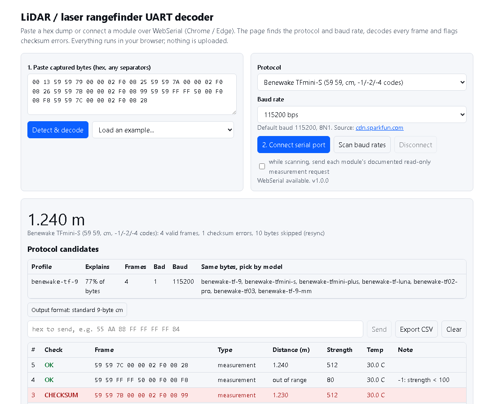

# LiDAR / laser rangefinder UART decoder

Find out what your laser rangefinder or single-point LiDAR is saying on its serial port: paste a
hex dump or plug the module in, and this tool detects the protocol and baud rate, decodes every
frame to metres and flags checksum errors.

**Open it in the browser, no install: <https://erditech.github.io/lrf-uart-protocol-decoder/>**
(WebSerial in desktop Chrome / Edge; paste mode works in any browser)

[](https://github.com/ErdiTech/lrf-uart-protocol-decoder/actions/workflows/ci.yml)
[](https://pypi.org/project/lrf-uart-decoder/)
[](LICENSE)



## Supported modules

| Vendor | Modules | Frame | Default baud | Profile(s) |
|---|---|---|---|---|
| Benewake | TFmini, TFmini-S, TFmini Plus, TF-Luna, TF02-Pro, TF03 | `59 59 DL DH SL SH TL TH SUM`, string mode | 115200 | `benewake-*`, `ascii-metres` |
| LightWare | SF30/D (binary protocol), SF10 / SF11 (ASCII serial) | `AA flags ID data CRC16`, `22.48 m\r\n` | 115200 | `lightware-binary`, `ascii-metres` |
| Chengdu JRT | phase-shift laser distance sensors (U81 / U85 / M88 class) | `AA 00 00 22 00 03 dddd qq SUM` | 19200 | `jrt-aa` |
| Nooploop | TOFSense, TOFSense-F | `57 00` 16-byte frame, query frame | 921600 | `nooploop-tofsense` |
| DFRobot | SEN0366 50 / 80 m laser distance sensor and the identical 80 m modules | `80 06 83 "123.456" CS` | 9600 | `dfrobot-sen0366` |
| ERDI | LRF50H ... LRF1500H, LRF22VB, LRF50VB, LR1000E2 ... LR2000E4, LRF1200A1, LRF3000A1, SPD1200 | `5C lo hi chk`, `55 AA fn .. SUM` | 460800 / 115200 | `erdi-*` |

Every profile is built from the vendor's public manual or product page. Frame tables, checksum
rules, invalid-reading codes and source links are in [docs/PROTOCOLS.md](https://github.com/ErdiTech/lrf-uart-protocol-decoder/blob/main/docs/PROTOCOLS.md).
Missing a module? Open an issue with a hex capture and a link to its manual.

## 30-second start

**Browser.** Open the [live page](https://erditech.github.io/lrf-uart-protocol-decoder/), paste
bytes from any serial terminal and press **Detect & decode**. With a USB-UART adapter attached,
press **Scan baud rates**: the page listens at 9600 ... 921600 bps and picks the rate and protocol
that explain the most bytes. Tick the request box for modules that only answer when asked
(ERDI LR series, JRT, DFRobot SEN0366, TOFSense in query mode).

**Python.**

```bash
pip install "lrf-uart-decoder[serial]"

lrf-decoder "AA 00 00 22 00 03 00 00 05 F6 00 45 65"     # auto-detects jrt-aa -> 1.526 m
lrf-decoder --hex-file dump.txt                          # text hex dump from any terminal
lrf-decoder --file capture.bin --profile benewake-tf-luna
lrf-decoder --port COM5 --scan --probe                   # find baud + protocol on a live port
lrf-decoder --port /dev/ttyUSB0 --profile benewake-tfmini-s --json
lrf-decoder --list                                       # every profile with its source
```

```python
from lrf_decoder import Decoder, detect, parse_hex

data = parse_hex("59 59 79 00 00 02 F0 08 25")
print(detect(data)[0]["family"])           # benewake-9
dec = Decoder("benewake-tfmini-s")
for frame in dec.push(data):                # feed serial chunks as they arrive
    print(frame["distance_m"], frame["strength"], frame["temp_c"], frame["ok"])
```

**JavaScript** (browser or Node, no dependencies): `docs/decoder.js` exports `Decoder`,
`detect`, `parseHex` and the `PROFILES` table.

## What it does

- **Protocol detection**: every protocol family is tried on the capture and ranked by how many
  bytes it explains, so `00 13 59 59 79 ...` is identified as Benewake even with noise in front.
- **Checksum checking**: failed frames are kept and highlighted instead of silently dropped,
  which is usually the first clue for a wrong baud rate, a missing ground or a 5 V / 3.3 V
  mismatch.
- **Per-model rules**: TFmini-S `-1/-2/-4` codes, TF-Luna and TFmini Plus low-strength
  zeros, TF02-Pro's 4500 cm, ERDI out-of-range markers and STA bytes are reported as invalid
  readings rather than real distances.
- **Requests and replies**: host commands in a two-way capture (ERDI `55 AA 88 ...`, JRT
  `AA 00 00 20 ...`, DFRobot `80 06 02 78`, TOFSense query) are labelled, so a full logic
  analyser export reads as a conversation.
- **Streaming**: frames split across USB packets are reassembled; garbage is skipped with
  byte-level resync.
- **Same bytes, different units**: an ERDI `5C 02 11 EC` is 43.54 m on an H-series module and
  4.354 m on a VB module; Benewake has a mm output mode. Detection reports the family and lists
  the models that share it, so pick by part number.

## Tests

```bash
node --test tests/                     # Node 20+
pip install pytest . && python -m pytest -q python
```

Both suites read the same golden vectors from [tests/vectors.json](https://github.com/ErdiTech/lrf-uart-protocol-decoder/blob/main/tests/vectors.json); each
vector says whether its bytes are printed in the cited manual or assembled from the manual's
field table.

## Contributing a protocol

Add a parser and a `PROFILES` entry in `docs/decoder.js` and `python/lrf_decoder/core.py`, add
vectors to `tests/vectors.json`, and document the frame with its source URL in
`docs/PROTOCOLS.md`. Only use values from the manufacturer's manual or a vendor capture.

## Related projects

- [ErdiTech/erdi-lrf-drivers](https://github.com/ErdiTech/erdi-lrf-drivers): Python, Arduino and ROS 2 drivers plus transcribed protocol documents for ERDI modules
- [laser-rangefinder-module-database](https://github.com/ErdiTech/laser-rangefinder-module-database): open dataset of laser rangefinder specifications
- [awesome-laser-rangefinder](https://github.com/ErdiTech/awesome-laser-rangefinder): curated list of laser rangefinder resources

Maintained by ERDI TECH LTD ([erdilrf.com](https://erdilrf.com/?utm_source=github&utm_medium=readme&utm_campaign=lrf-uart-protocol-decoder)), makers of 905 / 1535 nm laser rangefinder modules.
Benewake, LightWare, JRT, Nooploop and DFRobot are trademarks of their owners; this project is
not affiliated with them.

## License

MIT, see [LICENSE](https://github.com/ErdiTech/lrf-uart-protocol-decoder/blob/main/LICENSE).
